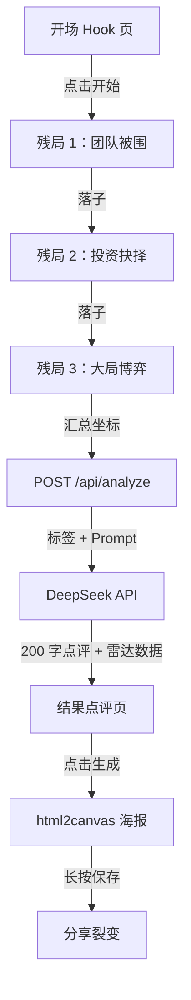

# 📄 PRD｜黑白潜意识 · AI 围棋心理沙盘（MVP Demo）

## 1. 产品概述

- **一句话定位**：将围棋残局降维包装成 1 分钟即玩即测的「潜意识决策性格测试」H5，通过落子坐标映射性格标签 + 大模型生成扎心点评，最终生成可裂变海报。
- **目标用户**：泛大众圈层（职场青年、投资者、琴童家长），不针对硬核围棋爱好者。
- **本次 Demo 范围**：单机可跑通完整链路（开场 → 落子 → AI 点评 → 海报），含 3 套残局题库与坐标热力图映射规则；后端走 DeepSeek API，无 Key 时自动降级到内置 mock 话术。

## 2. 核心功能

### 2.1 用户角色
| 角色 | 进入方式 | 权限 |
|------|----------|------|
| 普通玩家 | 微信 H5 链接 | 完整体验 3 关残局 + AI 点评 + 海报生成 |

### 2.2 功能模块（单页 SPA + 分步流程）
1. **开场 Hook 页**：禅意黑白首屏 + slogan + 开始按钮。
2. **落子交互页**：渲染 9×9 简化围棋盘（demo 规模），加载残局布局，监听点击落子。
3. **结果点评页**：展示坐标热力图标签 + 大模型 200 字犀利点评。
4. **海报裂变页**：棋盘截图 + 评语 + 二维码合成，长按保存。

### 2.3 页面详情

| 页面 | 模块 | 功能描述 |
|------|------|----------|
| 开场 Hook | 禅意首屏 | 黑白渐变 + 飘墨粒子 + slogan「你以为你在下棋，其实是你的潜意识在做决定」+ 「开始觉察」CTA |
| 落子交互 | 残局叙事卡 | 顶部展示情境文案（如「你的团队正陷入重围」），底部进度「第 X / 3 关」 |
| 落子交互 | 9×9 棋盘 | 自绘 Canvas 棋盘（黑白子 + 星位），预设残局布局，点击交叉点落黑子并显示标号 |
| 结果点评 | 性格雷达 | 5 维度（沉没成本 / 风险偏好 / 大局观 / 执念 / 决断力）迷你雷达图 |
| 结果点评 | AI 评语 | 200 字扎心心理测算 + 标签云 |
| 海报裂变 | 海报合成 | html2canvas 生成 9:16 竖版海报，含棋盘缩略图 + 评语 + 占位二维码 |

## 3. 核心流程

用户点击 H5 → 进入开场页 → 点击「开始觉察」→ 进入第 1 关残局 → 阅读情境文案 → 在棋盘点击落子 → 自动进入下一关 → 完成 3 关后 → 前端汇总 3 次落子坐标 → 调用后端 `/api/analyze` → 后端转标签 + 调 DeepSeek → 返回点评 + 雷达图数据 → 前端展示结果页 → 点击「生成专属海报」→ html2canvas 合成 → 长按保存。

## 4. 用户界面设计

### 4.1 设计风格
- **主题**：极简禅意水墨 × 现代极客感
- **主色**：宣纸米白 `#F5F1E8` × 墨黑 `#0A0A0A` × 朱砂红点缀 `#C8392B`
- **辅助色**：竹青 `#5A7A6B`、淡金 `#B89968`
- **字体**：标题用思源宋体 / Noto Serif SC（厚重、文人气），正文用霞鹜文楷 / LXGW WenKai（书卷气），数字与英文用 JetBrains Mono（极客反差）
- **按钮**：墨块式，悬停晕染动画
- **布局**：竖版 H5 单列，大量留白，关键文案居中
- **动效**：墨滴落子涟漪、卷轴翻页、字符逐字浮现

### 4.2 页面设计概览

| 页面 | 模块 | UI 要素 |
|------|------|--------|
| 开场 Hook | 首屏 | 米白渐变背景 + 飘墨粒子 canvas + 居中宋体 slogan + 朱砂方印「始」+ 底部「开始觉察」墨块按钮 |
| 落子交互 | 残局卡 | 顶部情境文案（逐字浮现）+ 中部棋盘 + 底部「第 X 关」进度条 + 跳过链接 |
| 结果点评 | 雷达 + 评语 | 顶部「潜意识侧写」标题 + 中部雷达图 + 标签云 + 底部 200 字点评（打字机效果）+ 「生成海报」CTA |
| 海报裂变 | 海报预览 | 9:16 竖版海报：顶部 slogan + 棋盘缩略图 + 中部评语 + 底部二维码占位 + 长按提示 |

### 4.3 响应式
- **移动优先**：基准 375×667，最大 480px 居中。
- **桌面适配**：居中卡片（max-width 480px），左右留白显禅意。
- **触控优化**：棋盘交叉点点击热区放大至 32×32px。

## 5. 残局题库（3 关）

| 关卡 | 情境文案 | 棋盘状态 | 关键热区 → 标签 |
|------|----------|----------|----------------|
| 第 1 关 · 围 | 「你的团队正陷入重围，作为黑方，你的第一反应落在哪里？」 | 黑 3 子被白 5 子包围 | 死子附近 → 执念深/沉没成本；外围 → 大局观/止损；贴敌 → 激进/高风险 |
| 第 2 关 · 贪 | 「眼前是一块肥肉，但后手有险。你会落子抢食，还是退守？」 | 黑白交错的中央空白 | 中央肥肉 → 贪婪/过度自信；退守角部 → 风控/稳健；边线 → 保守/逃避 |
| 第 3 关 · 局 | 「大局未定，胜负系于一手。你的直觉指向何处？」 | 全盘稀疏开局 | 角部星位 → 大局观/格局；天元 → 掌控欲；边线 → 边缘性格/防御 |

## 6. 性格维度（雷达图 5 维）
1. **沉没成本谬误**（执念深浅）
2. **风险偏好**（激进 vs 稳健）
3. **大局观**（局部 vs 全局）
4. **决断力**（果断 vs 犹豫，通过落子时长辅助判断）
5. **掌控欲**（主动出击 vs 被动应对）

## 7. Demo 验收标准
- [ ] 3 关残局可依次落子，无卡死。
- [ ] 落子坐标正确映射 5 维性格标签。
- [ ] 后端 `/api/analyze` 在有 `DEEPSEEK_API_KEY` 时调用真实 API，无 Key 时降级 mock。
- [ ] 结果页雷达图 + 200 字点评正常展示。
- [ ] html2canvas 可生成海报并支持长按保存。
- [ ] 移动端 375 宽度下布局正常。
- [ ] 全流程 ≤ 60 秒。
