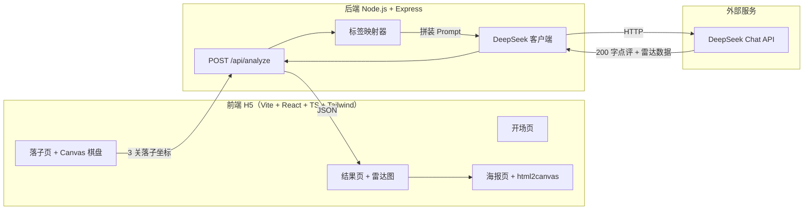

# 🏗️ 技术架构｜黑白潜意识 · AI 围棋心理沙盘（MVP Demo）

## 1. 架构设计



## 2. 技术选型

- **前端**：React 18 + TypeScript + Vite 5 + TailwindCSS 3
  - 自绘 Canvas 棋盘组件（不依赖 WGo.js，更易控制禅意视觉与点击热区）
  - `html2canvas` 生成海报
  - `framer-motion` 做翻页/落子动效
- **后端**：Node.js 18 + Express 4 + TypeScript
  - 单一 `/api/analyze` 接口
  - `node-fetch` 调用 DeepSeek Chat Completions
  - 无数据库（demo 不持久化）；可选内存计数用于统计
- **AI**：DeepSeek `deepseek-chat` 模型（兼容 OpenAI 协议）
- **环境变量**：`DEEPSEEK_API_KEY`、`DEEPSEEK_BASE_URL`（默认 `https://api.deepseek.com`）、`PORT`

## 3. 路由定义

| 路径 | 用途 |
|------|------|
| `/` | H5 主应用（React SPA） |
| `/api/analyze` | 后端分析接口 |
| `/api/health` | 健康检查 |

## 4. API 定义

### 4.1 `POST /api/analyze`

**Request Body**
```typescript
interface AnalyzeRequest {
  moves: Array<{
    puzzleId: 'siege' | 'greed' | 'overall';
    x: number;          // 0-8 棋盘列
    y: number;          // 0-8 棋盘行
    elapsedMs: number;  // 思考时长
  }>;
}
```

**Response Body**
```typescript
interface AnalyzeResponse {
  radar: {
    sunkCost: number;      // 0-100 沉没成本谬误
    riskAppetite: number;  // 风险偏好
    bigPicture: number;    // 大局观
    decisiveness: number;  // 决断力
    controlDesire: number; // 掌控欲
  };
  tags: string[];          // 性格标签，如「执念深」
  comment: string;         // 200 字扎心点评
  headline: string;        // 一句话人设，如「走钢丝的冒险家」
}
```

### 4.2 标签映射规则（后端内置）

每关棋盘预定义「热区矩形 → 标签 + 维度加减分」：

```typescript
// 伪代码示例
const HEATMAP = {
  siege: [
    { rect: { x0:2, y0:2, x1:4, y1:4 }, tags: ['执念深','沉没成本谬误'], delta: { sunkCost:+30, decisiveness:-10 } },
    { rect: { x0:0, y0:0, x1:8, y1:8 }, tags: ['大局观好','果断止损'], delta: { bigPicture:+25, riskAppetite:-15 } },
    { rect: { x0:5, y0:5, x1:8, y1:8 }, tags: ['极度激进','风险偏好高'], delta: { riskAppetite:+30, controlDesire:+20 } },
  ],
  // ...其余两关同理
};
```

### 4.3 DeepSeek Prompt 模板

```
你是一位融合围棋哲学与行为心理学的人格侧写师。
用户刚刚完成了 3 关围棋残局测试，落子标签如下：{tags}
雷达数据：{radar}
请用 200 字以内、犀利但建设性的中文，写出 TA 的「潜意识决策侧写」，
开头用 8 字以内金句点题（如「你是走钢丝的冒险家」），中间结合职场/投资场景，
结尾给出一句行动建议。避免说教与套话。
```

### 4.4 Mock 兜底
当 `DEEPSEEK_API_KEY` 未配置或调用失败时，后端基于标签 + 雷达数据从内置话术池中拼装结果，保证 demo 可独立运行。

## 5. 服务架构

```
client (browser)
   │  POST /api/analyze {moves}
   ▼
express server
   ├── middleware: cors, json
   ├── /api/analyze
   │     ├── mapMovesToTags(moves) → {tags, radar}
   │     ├── buildPrompt(tags, radar)
   │     └── callDeepSeek(prompt) ──┐
   │                                ▼
   │                          DeepSeek API
   │                                │
   │     ◄── {comment, headline} ◄──┘
   └── fallback: mockComment(tags, radar) if no key
```

## 6. 目录结构

```
go/
├── package.json            # 根工作区（concurrently 调度前后端）
├── client/                 # 前端
│   ├── index.html
│   ├── src/
│   │   ├── main.tsx
│   │   ├── App.tsx
│   │   ├── components/
│   │   │   ├── GoBoard.tsx       # Canvas 棋盘
│   │   │   ├── RadarChart.tsx    # 性格雷达
│   │   │   ├── Poster.tsx        # html2canvas 海报
│   │   │   └── scenarios/        # 3 关残局配置
│   │   ├── stages/               # 4 个流程页
│   │   ├── api/                  # fetch 封装
│   │   └── styles/
│   ├── tailwind.config.js
│   └── vite.config.ts
├── server/                 # 后端
│   ├── src/
│   │   ├── index.ts
│   │   ├── routes/analyze.ts
│   │   ├── lib/
│   │   │   ├── heatmap.ts        # 坐标 → 标签 + 雷达
│   │   │   ├── deepseek.ts        # API 客户端
│   │   │   └── mock.ts            # 兜底话术
│   │   └── prompts.ts
│   └── tsconfig.json
└── .env.example
```

## 7. 启动方式

```bash
# 根目录
npm install
npm run dev        # 同时启动前端 (5173) 与后端 (3001)
# 前端通过 vite proxy 转发 /api → 3001
```

## 8. 性能与安全
- 前端棋盘渲染 < 100ms，单次落子响应 < 50ms。
- 后端 DeepSeek 调用超时 15s，失败降级 mock。
- `/api/analyze` 加简单频率限制（10 req/min/IP）防止滥用。
- 不收集用户隐私，无登录态。
